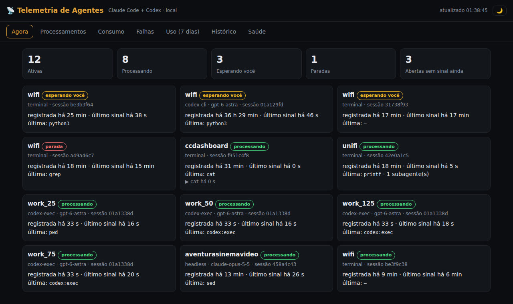

# 📊 CC Dashboard — paneles en vivo en Claude

[](https://inematds.github.io/ccdashboard/guia/es/)

**🇧🇷 [Português](README.md) · 🇺🇸 [English](README.en.md) · 🇪🇸 [Español](README.es.md)**

## Qué es

CC Dashboard es un kit en español para usar los Dashboards de Claude, paneles que guardan las consultas y rehacen las cuentas cada vez que los abres. Sirve para dueños de pequeños negocios y para quienes usan Claude Code todos los días. Trae prompts listos para armar paneles del negocio (dinero, atrasos, fugas) y un plan para medir tu propio Claude Code (costo estimado, herramientas, fallas). Para usarlo necesitas un plan de pago de Claude y, en las partes con base de datos, una cuenta gratuita en Supabase.

## 📖 Guía de uso

Guía completa (landing + paso a paso): **https://inematds.github.io/ccdashboard/guia/es/**

> Nota: los archivos de prompts (`prompts/*.md`) y el `PLANO.md` están en portugués.

## Cómo funciona

Un Dashboard de Claude no guarda números: guarda **consultas**. Cada vez que lo abres o lo actualizas, vuelve a ejecutar las consultas sobre los datos conectados. Al hacer clic en un número, ves la consulta y la hora de la última actualización.

**Negocio**

```
Apps (CRM, hoja de cálculo, base de datos) → Conector en Claude → [Base central en Supabase] → Dashboard → Copia programada
```

- Una pregunta que cabe en una sola app: conector + prompt y listo.
- Una pregunta que cruza apps (horas × facturas, suscripciones × cobros): los registros deben copiarse a una base central (Supabase = Postgres alojado), que guarda el historial y permite cruzar.

**Claude Code**

```
Claude Code (OpenTelemetry) → Recolector en Supabase → Tablas en bruto (7 días) → Resumen diario (10 min) → Dashboard
```

- Claude Code envía su propia telemetría (modelo, tokens, costo estimado, herramientas, duración, fallas).
- El recolector guarda **solo campos de una lista permitida** y descarta el texto de prompts y respuestas, comandos completos, rutas, entradas y salidas de herramientas, texto de error y correo electrónico. Del shell, guarda solo el nombre del programa.
- Un resumen diario se recalcula cada 10 minutos; los datos en bruto se borran a los 7 días.

## Cómo usar

| Paso | Qué hacer | Archivo |
|---|---|---|
| 1 | Activar el conector de la app en *Customize → Connectors* | — |
| 2 | Pedir el panel con pregunta, definiciones y "no modifiques datos" | `prompts/01-dashboard-negocio.md` |
| 3 | Verificar un número en el origen antes de actuar | `prompts/02-conferir-numero.md` |
| 4 | Cruzar apps en una base central en Supabase | `prompts/03-base-central.md` |
| 5 | Programar la actualización de la base | `prompts/05-agendar-atualizacao.md` |
| 6 | Diagnóstico del negocio → plan → panel de seguimiento | `prompts/06-diagnostico-negocio.md` |
| 7 | Armar el panel de Claude Code (base de datos, recolector, pestañas) | `prompts/04-observabilidade-claude-code.md` |
| 8 | Activar la telemetría en `~/.claude/settings.json` y **reiniciar** Claude Code | `config/claude-code-otel.example.json` |

Supabase de solo lectura y restringido a un proyecto (conector personalizado):

```
https://mcp.supabase.com/mcp?project_ref=SEU_PROJECT_REF&read_only=true
```

Si no llega nada al recolector: `claude --debug-file /tmp/cc.log` y busca líneas `[3P telemetry]`. La tabla de síntomas (401, 404, 415, tarjetas vacías) está al final de `prompts/04-observabilidade-claude-code.md`.

## Telemetría de agentes (Frente C) — local, sin nube

Un panel en tu propia máquina con **todas** las sesiones de Claude Code (terminales, bots, `claude -p`, subagentes) y de Codex, en vivo: qué se está procesando, qué te espera, qué falló, tokens y costo estimado. Sin API, sin cuenta nueva.



```bash
./help.sh                          # ayuda completa
./help.sh ligar                    # hooks + OpenTelemetry en ~/.claude/settings.json (con copia), panel y mantenimiento
telemetria/telemetria.sh status    # qué está activo ahora
./help.sh desligar                 # quita todo del settings.json y detiene los servicios (la base se conserva)
systemctl --user stop telemetria-painel.service   # solo pausar el panel
```

- **Panel:** `http://127.0.0.1:8766/` y, en la red local, `http://<ip-de-la-maquina>:8766/` (direcciones en `TELEMETRIA_HOSTS`, redes permitidas en `TELEMETRIA_REDES`). Pestañas: Ahora, Procesos, Consumo, Fallas, Uso, Historial, Salud.
- **Qué se guarda:** solo nombres (proyecto, herramienta, skill, programa) y números. Nunca prompts, respuestas, comandos completos, rutas de archivo ni salida de herramientas. Base en `~/.local/share/telemetria-agentes/` (30 días de eventos + resumen diario).
- **Costo de máquina (medido):** ~60 ms más por llamada de herramienta, ~13 MB de RAM, 3–5 MB de disco por día (tope ~150 MB). Nada sale de la máquina.
- **Límites:** tokens y costo solo en sesiones de Claude Code abiertas después de activarla; el costo es una estimación a precio de API (Codex no informa precio); el panel no tiene contraseña — cualquier dispositivo de la red permitida lo ve. Probado en Linux.
- Detalles, pruebas y fases: [`telemetria/PLANO.md`](telemetria/PLANO.md) (en portugués).

## Requisitos previos

- Plan de pago de Claude: Pro, Max, Team o Enterprise (función en beta, cuenta en el uso del plan).
- Cuenta de Supabase gratuita (500 MB; el proyecto gratuito se pausa tras una semana sin uso) — para la base central y Claude Code.
- Claude Code — solo para el panel de observabilidad.

## Límites

- **Muestra, no avisa.** Una alerta exige una rutina programada aparte.
- **El costo es una estimación** a precio de API; en Pro/Max vale la suscripción.
- **Cada persona necesita su propia conexión** al proyecto de Supabase para ver las tarjetas.
- **Los nombres quedan guardados** (skills, repositorios, servidores MCP) — piensa en quién lo ve.
- **Solo Claude Code**; el chat de la app y Cowork no entran.
- **Pruébalo en tu sistema** (Linux, Windows, Mac) antes de confiar en el flujo.

## Estructura

```
PLANO.md                               plan por fases (Frente A negocio, Frente B Claude Code)
telemetria/                            Frente C: telemetría local de agentes (Claude Code + Codex)
help.sh                                ayuda + activar/desactivar telemetría
prompts/01-dashboard-negocio.md        panel a partir de una app
prompts/02-conferir-numero.md          checklist para verificar un número
prompts/03-base-central.md             base central en Supabase
prompts/04-observabilidade-claude-code.md  prompt único del panel de Claude Code + diagnóstico
prompts/05-agendar-atualizacao.md      copia programada
prompts/06-diagnostico-negocio.md      diagnóstico de solo lectura → plan → seguimiento
config/claude-code-otel.example.json   bloque env de Claude Code
guia/                                  página landing + guía (PT, EN, ES)
```

## Estado

La **telemetría de agentes (Frente C)** ya está implementada y probada en Linux (`telemetria/`). Plan + kit de prompts. El panel de Claude Code aún no se ha armado de punta a punta a partir de este kit; trata la primera ejecución como piloto y verifica cada paso antes de dar el OK a Claude.

---

[INEMA.CLUB](https://inema.club)
